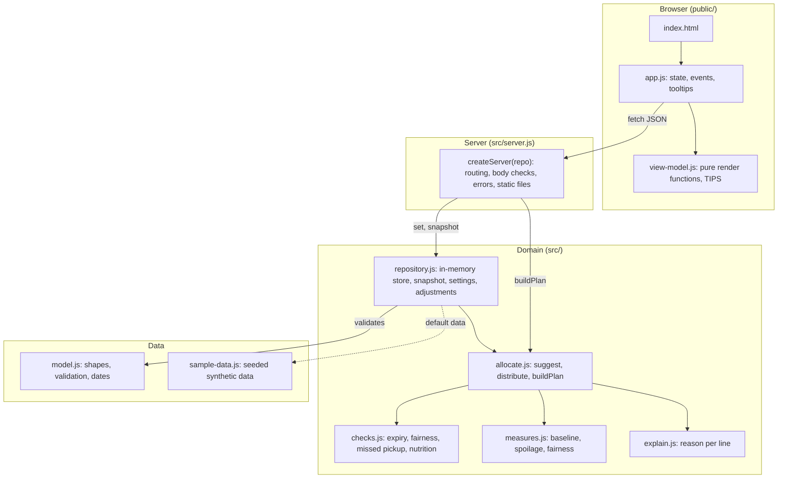

# PantryShare Technical Design

**Status:** current as of branch `pantryshare-next` (built on commit `98f599e`)
**Diagrams:** [PantryShare architecture (Lucid)](https://lucid.app/lucidchart/34cf6679-d4e5-4de5-bea2-5aef0b76fa31/edit), with a Mermaid copy below
**Wireframes:** [PantryShare wireframes (Lucid)](https://lucid.app/lucidchart/ac593073-7108-432f-bb79-3f1e29ff0cf3/edit)
**Related:** `PantrySharePRD.html` (the brief), `UAT-REPORT.md`, and the requirements, plan and review records under `aidlc/spaces/default/intents/261107-pantry-allocation-planne/`

## 1. Purpose and scope

PantryShare helps a food bank's distribution coordinator build a fair, explainable weekly allocation of food to partner pantries, and keep waste low. It is a proof of concept (the AI-DLC `poc` scope) that works on synthetic data only.

In scope: loading data, suggesting a quantity of each item for each partner, flagging expiry, fairness, missed pickups and nutrition gaps, explaining every quantity, letting the coordinator adjust any quantity, and reporting two success measures.

Out of scope (from the brief): tracking individual clients, volunteers, fundraising, delivery routes, and a connection to the food bank's inventory system. Not built: logins, a database, partner-facing views.

## 2. Design goals

| Goal | How the design meets it |
|------|-------------------------|
| Fair and explainable | Fair share is a plain formula (section 6); every line carries a written reason (`explain.js`). |
| The coordinator stays in control | Suggestions are only suggestions. Any line can be changed and reset. Requests are shown but never change quantities. |
| Repeatable | Sample data comes from a fixed seed, and the plan is a pure function of its input (NFR4). |
| Easy to run and test | Node 22, plain JavaScript, no packages to install, Node's built-in test runner. |
| No personal data | Inputs containing personal fields are rejected (NFR1). |

## 3. Architecture overview

Four layers. The browser talks JSON to a small HTTP server. The server calls a domain layer that turns data and the coordinator's settings into a plan. Everything lives in one Node process, in memory.



Design choices worth knowing:

- **Stateless plan, stateful settings.** The plan is recomputed in full from a snapshot on every request. Only the coordinator's settings (conversion factors, expiry dates, adjustments) are kept, in the repository. This keeps the engine simple and testable. It costs a full recompute per request, which takes about 65 ms for 60 partners.
- **Pure view code.** `view-model.js` only turns plan JSON into HTML strings. It runs in the browser and in Node tests alike, so the screen logic is tested without a browser.
- **No dependencies.** Built-in `http`, `fs`, `node:test`. Nothing to install or patch.

## 4. Components

| File | Responsibility | Key exports |
|------|----------------|-------------|
| `src/model.js` | Data shapes, validation, date helpers, the list of personal fields to reject | `validateDataset`, `isPerishable`, `addDays`, `daysBetween`, `ValidationError` |
| `src/sample-data.js` | Built-in synthetic data from a fixed seed: 60 partners, 14 inventory records in several units, 13 weeks of history, requests, nutrition targets | `buildSampleData`, `PLAN_DATE` |
| `src/repository.js` | In-memory store. Builds the clean snapshot the engine plans from. Holds conversion factors, expiry overrides and adjustments, and validates every change | `createRepository`, `buildSnapshot` |
| `src/allocate.js` | The allocation engine and the plan builder | `suggest`, `distribute`, `buildPlan` |
| `src/checks.js` | Fixed-threshold checks: expiry window, fairness band, missed pickup, nutrition gap | `expiryFlags`, `fairnessOf`, `missedPickupIds`, `nutritionFlags` |
| `src/measures.js` | Baselines from history, spoilage and fairness measures, weekly comparison | `buildMeasures`, `computeBaseline` |
| `src/explain.js` | The plain-language reason for each allocation line | `explainLine` |
| `src/server.js` | HTTP routes, JSON body handling, error mapping, static files | `createServer` |
| `public/view-model.js` | Pure render functions, the tooltip texts, escaping | `render*`, `TIPS`, `tipIcon`, `escapeHtml` |
| `public/app.js` | Page state, event handling, tooltip behavior | (entry point) |

## 5. Data model

**Input dataset** (validated by `validateDataset`):

| Entity | Fields | Notes |
|--------|--------|-------|
| Partner | `id`, `name`, `households`, `storage {refrigeratorKg, freezerKg}`, `pickupDay` (1 to 5) | Households may be missing or zero; the partner is then left out and flagged |
| Inventory record | `id`, `item`, `category` (`produce`, `dairy`, `meat`, `dry`), `unit`, `quantity`, `expiry` | Expiry may be missing; the record is then left out and flagged |
| Request | `partnerId`, `item`, `kg`, `note` | Display only |
| Pickup | `partnerId`, `weekStart`, `collected` | Last week's record drives the missed-pickup flag |
| History week | `weekStart`, `receivedKg`, `spoiledKg`, `partnerAllocations[]` | Source of the baselines |
| Targets | percent per category, adding to 100 | Nutrition check |
| Conversions | `item -> unit -> kg per unit` | Set by the coordinator or preset |

Validation rejects: unknown categories, bad dates, negative numbers, duplicate ids, nutrition targets that do not add to 100, and any record carrying a personal field (`clientName`, `address`, `phone`, `email`, `dob`, and similar).

**Snapshot** (`buildSnapshot`, pure): partners with households, items grouped into lots sorted soonest-expiring first and converted to kg, lists of what was left out and why, stock already expired on the plan date (set aside, counted as spoiled), plus requests, pickups, targets, history and the coordinator's settings.

**Plan** (returned by `GET /api/plan`): `planDate`, `totalHouseholds`, `partners[]`, `items[]`, `excluded`, `flags[]`, `measures`, `adjustments`, `totals`.

- A partner has `totalKg`, `fairKg`, `deviationPct`, `outsideBand`, `missedLastPickup`, `flags[]` and `lines[]`.
- A line has `fairKg`, `suggestedKg`, `adjustedKg`, `kg` (final), `lots[]`, `block` (why nothing was given), `requestedKg`, `note`, `shortfallKg`, `warnings[]` and `explanation`.
- Flag types: `fairness`, `missed-pickup`, `nutrition`, `storage` (partner); `surplus`, `over-allocated`, `requests-exceed-stock`, `expiry`, `expired`, `excluded-item`, `excluded-record`, `excluded-partner` (item and partner level).
- Line warning types: `storage`, `pickup`, `over-allocated`.

## 6. Allocation algorithm

Rules (decisions D1 to D6 in the code plan, requirements FR2 and FR3):

1. **Need** is households served.
2. **Fair share** of an item for a partner is `partner households / total households * item stock on hand`. Stock on hand excludes stock already expired on the plan date.
3. Stock is given **soonest-expiring lot first**, and only up to each partner's fair share.
4. A partner is **ineligible** for a lot when the item needs refrigeration (dairy) or a freezer (meat) and the partner has none, or when the lot expires on or before the partner's next pickup. Ineligible partners get none of that lot.
5. Whatever cannot be given stays **unallocated** and is flagged for the coordinator.
6. **Requests** are never an input to quantities.

`suggest()` runs per item, then per lot. For each lot it builds the list of eligible partners, each with weight (households) and a cap (the part of its fair share not yet used), and calls `distribute()`.

`distribute(amount, parties)` is water-filling: share the amount in proportion to weight; any party whose share would pass its cap is held at the cap and the surplus is shared among the rest, repeating until nothing is left or everyone is capped. It never gives a party more than its cap.

Worked example (from the tests): two partners with 100 households each, a 100 kg lot expiring soon and a 300 kg lot expiring later. Fair share is 200 kg each. The 100 kg lot goes 50 kg each, then 150 kg each from the later lot, so each gets 200 kg and nothing is left over.

**Adjustments.** The coordinator's quantity replaces the suggestion for that partner and item. The difference is taken from, or returned to, the lots soonest-first (`finalRemainders`). Totals, fairness, storage warnings and over-stock warnings all use the final quantity. The spoilage and fairness measures use the suggested plan, before adjustments.

**Fairness test (D2).** A partner is compared only on items it is eligible for: its allocated weight against the sum of its fair shares of those items. More than 20 percent either way is flagged, so being barred from an item never counts against a partner.

## 7. How a plan is built

`buildPlan(snapshot)` runs these steps for every request (see page 2 of the Lucid diagram):

1. `suggest()` produces suggested quantities and lot usage.
2. Adjustments are applied to lines; lot remainders are recalculated.
3. Per partner: storage and pickup warnings (a perishable line over the partner's capacity, or an item that expires before pickup), then fairness, missed-pickup and nutrition flags, then the explanation text.
4. Per item: unallocated stock (surplus) or over-allocation, requests above stock, expiry flags (unallocated stock within 3 days of expiry).
5. Over-stock warning on any line the coordinator changed, when its item is over-allocated.
6. Left-out items, records and partners become flags.
7. `buildMeasures()` computes baselines from history, then spoilage and fairness for the suggested plan.

## 8. Thresholds and measures

| Item | Value | Where |
|------|-------|-------|
| Expiry flag window | 3 days | `checks.js` |
| Fairness band | 20% above or below fair share | `checks.js` |
| Nutrition gap | more than 10 points below target share | `checks.js` |
| Spoilage target | at least 25% below baseline | `measures.js` |

- **Baseline** is the total over the 13 history weeks divided by the number of weeks (A2). The spoilage target is 75% of the baseline spoilage percentage.
- **Plan spoilage** counts unallocated stock, stock given to a partner whose pickup is after the stock expires, and stock already expired, as a percentage of received weight.
- **Fairness measure** passes when no partner is outside the band on the suggested plan.

## 9. HTTP API

All bodies are JSON. JSON responses carry `Cache-Control: no-store`.

| Method and path | Body | Result |
|-----------------|------|--------|
| `GET /api/plan` | none | The full plan |
| `POST /api/adjust` | `{partnerId, item, kg}`; `kg: null` clears the adjustment | The updated plan |
| `POST /api/settings` | `{type: "conversion", item, unit, factor}` or `{type: "expiry", recordId, date}` | The updated plan |
| `GET /` and static paths | none | Files from `public/` |

Errors return `{ "error": "<plain message>" }`:

| Status | When |
|--------|------|
| 400 | Bad JSON, not a JSON object, or a validation failure (for example a factor of 0 or less, an unknown partner or item, a date that is not `YYYY-MM-DD`, `kg` outside 0 to 1,000,000) |
| 404 | Unknown API path, or a missing static file |
| 405 | Wrong method (with an `Allow` header) |
| 413 | Request body over 64 KB |
| 500 | Anything unexpected; logged on the server, a generic message to the client |

Static file paths are resolved against `public/` and rejected if they escape it.

## 10. Browser UI

- **Rendering.** `app.js` fetches the plan and calls the `render*` functions, which return HTML strings placed in the page. Every value from the data goes through `escapeHtml`.
- **State.** Page state is small: the plan, which partners are expanded, the search text and the flagged-only switch. Every change to settings goes to the server, and the returned plan replaces the page.
- **Tooltips.** All 29 tip texts live in `TIPS`. A small "i" button or a badge carries its text in `data-tip-text`. One floating box shows it on hover, keyboard focus or tap, follows the page when it scrolls, and closes on Escape. Buttons carry the text in their `aria-label`; badges carry a visually hidden copy. The nutrition tip names the category.
- **Phone layout.** Below 600 px each partner row becomes a card (CSS only, using `data-label`), so no column is cut off. The page never scrolls sideways.
- **Test hooks.** Every interactive element has a `data-testid`.

## 11. Non-functional requirements

| Requirement | Design response |
|-------------|-----------------|
| NFR1 no personal data | Personal field names rejected at validation; data is synthetic |
| NFR2 every line explained | `explainLine` runs for every line; a test checks all lines have one |
| NFR3 update within 2 seconds | Full recompute is about 65 ms for 60 partners; a test asserts the limit |
| NFR4 repeatable plan | Seeded data and a pure engine; a test runs the same data twice |

## 12. Security and limits

This is a local proof of concept. Known limits, not hidden:

- **No authentication.** Anyone who can reach the port can read the plan and change settings.
- **The server listens on all interfaces** by default. Bind it to `127.0.0.1` before sharing a network.
- **POST routes do not check `Content-Type` or `Origin`**, so a web page open in the coordinator's browser could send a cross-site request. Add both checks, and authentication, before any real use.
- **State is global and in memory.** All tabs and users share one set of adjustments, which are lost when the server restarts.
- **Good practice already in place:** escaping of all data in the page, a 64 KB body limit, input validation at the boundary, a path-traversal guard, no secrets, and no packages to patch.

## 13. Testing

47 tests with Node's built-in runner (`npm test`), all passing:

| File | Covers |
|------|--------|
| `model.test.js` | Data shape, personal fields rejected, seeded repeatability |
| `repository.test.js` | Conversion, left-out items and records, zero-household partners, expired stock, adjustments |
| `allocate.test.js` | Fair share, soonest-first, storage and pickup rules, surplus, requests above stock, over-stock warning |
| `checks.test.js` | Expiry window, fairness band edge (20% not flagged, 25% flagged), missed pickup, nutrition gap |
| `measures.test.js` | Baseline, spoilage scoring, weekly comparison, fairness pass or fail |
| `explain.test.js` | Every line explained; requests shown, never applied |
| `api.test.js` | Real server on a random port: adjust, storage warning, kept adjustments, 2-second limit, bad input |
| `view-model.test.js` | Totals, flags, escaping, filters, all 29 tooltips present and escaped, over-stock display, phone labels |

The seven UAT scenarios from the brief are in `UAT-REPORT.md`: five pass, one passes with a gap (short-dated dairy), one is partial (growing need).

## 14. Decisions and limitations

- **Need is households only.** The suggestion does not react to growth or to a partner's request. A rural pantry asking for more protein sees its request and note, and gets more only if the coordinator adjusts by hand (UAT-5).
- **Surplus is left unallocated and flagged** so no partner goes above fair share. Unplaced perishable stock can still spoil.
- **The baseline is synthetic.** The history was written for this app, so "meets target" shows the measures work, not that the method cuts spoilage in practice. The fairness result is also built in, because allocation never exceeds fair share.
- **Plan spoilage is a lower bound.** It leaves out food that is collected but not used, and missed-pickup allocations.
- **Fixed plan date** (2026-11-09) and one pickup weekday per partner.
- **Adjustments stay if an item leaves the plan.** They are then ignored, not deleted.
- **Over-stock is allowed with a warning**, not refused.

## 15. Extension points

- **Real data:** replace `buildSampleData` with a loader that returns the same dataset shape; `validateDataset` already guards it.
- **Persistence:** swap the repository's maps for a store behind the same functions (`setConversion`, `setExpiry`, `setAdjustment`, `snapshot`).
- **Need that reflects growth:** change how `fairKg` is computed in `suggest()`; the rest of the plan builds from it.
- **New flags or checks:** add a function in `checks.js` and call it in `buildPlan`; add a label and tooltip in `view-model.js`.
- **Hardening:** bind to localhost, check `Content-Type` and `Origin`, add authentication.

## 16. Running it

```
npm start                  # http://localhost:3000, or set PORT
npm test                   # all 47 tests
```

Requires Node.js 22 or newer. No install step.
